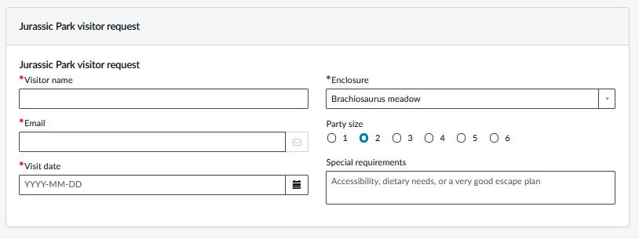

# Form Foundry

Form Foundry builds transient Service Portal form models from JavaScript or JSON definitions. It uses the OOB `spModel` directive without creating catalog questions or persisting answers.

## ScriptedFormBuilder

```javascript
var formModel = new ScriptedFormBuilder()
    .containerStart('visit_details', 'Jurassic Park visitor request', { displayTitle: true })
    .singleLineText('visitor_name', 'Visitor name', { mandatory: true })
    .email('email', 'Email', { mandatory: true })
    .date('visit_date', 'Visit date', { mandatory: true })
    .containerSplit()
    .selectBox('enclosure', 'Enclosure', {
        choices: [
            { label: 'Brachiosaurus meadow', value: 'brachiosaurus' },
            { label: 'Triceratops paddock', value: 'triceratops' },
            { label: 'Velociraptor enclosure', value: 'raptors' }
        ],
        value: 'brachiosaurus',
        mandatory: true
    })
    .numericScale('party_size', 'Party size', { min: 1, max: 6, value: '2' })
    .multiLineText('special_requirements', 'Special requirements', {
        placeholder: 'Accessibility, dietary needs, or a very good escape plan'
    })
    .containerEnd()
    .clientScript('onChange', 'Raptor enclosure advisory',
        'function onChange(control, oldValue, newValue, isLoading) {' +
        'if (isLoading || newValue !== "raptors") return;' +
        'g_form.addInfoMessage("Please keep your hands inside the vehicle.");' +
        '}',
        { fieldName: 'enclosure' }
    )
    .build();
```



<details>
<summary>Builder methods and options</summary>

| Method | Minimum input and confirmed behavior |
| --- | --- |
| `new ScriptedFormBuilder(options)` | Optional settings object. Set `attachmentGuid` when using attachments. |
| All field methods below | `(name, label, options)`, with optional `options`; return the builder. Names must be unique and match `[a-z][a-z0-9_]*`. |
| `singleLineText` | Name and label; single-line text. |
| `wideSingleLineText` | Name and label; wide single-line text. |
| `multiLineText` | Name and label; multiline text. |
| `reference` | `{ reference: 'sys_user' }`; reference table is required. Optional `searchField` (default `name`), `defaultOperator` (default `STARTSWITH`), and `qualifier` (default empty). |
| `yesNo` | Name and label; initial `value` must be `'Yes'`, `'No'`, or empty. |
| `html` | Name and label; optional `value` contains HTML. |
| `richTextLabel` | Name and label; optional `value` contains rich text. |
| `ipAddress` | Name and label; IP-address renderer. |
| `date` | Name and label; date renderer. |
| `dateTime` | Name and label; date/time renderer. |
| `duration` | Name and label; duration renderer. |
| `url` | Name and label; URL renderer. |
| `email` | Name and label; email renderer. |
| `label` | Name and label; displays the label. |
| `breakField` | Name and label; layout break. |
| `selectBox` | `{ choices: [{ label: 'Normal', value: 'normal' }] }`. Optional `includeNone` and `noneLabel`. |
| `multipleChoice` | Required `choices` array; radio choices. Optional `choice_direction` (default `down`). |
| `lookupSelectBox` | Required `choices` array. Optional `lookup_table`, `lookup_value` (default `sys_id`), `lookup_label`, `qualifier`, `includeNone`, and `noneLabel`. A qualifier requires `lookup_table`. Choices must still be supplied. |
| `lookupMultipleChoice` | Required `choices` array; same lookup metadata as `lookupSelectBox`, plus `choice_direction` (default `down`). No `includeNone`. |
| `numericScale` | Optional integer `min` (default `0`) and `max` (default `5`). Inclusive range, `max >= min`, at most 1,001 values. Generates choices; optional `value` must match the range. |
| `masked` | Name and label; optional `useConfirmation` (default `false`). A matching confirmation validator must be supplied separately. |
| `checkbox` | Name and label; initial `value` is boolean or string `true`/`false` (default `false`). Generates `checkbox_group_<name>`. |
| `requestedFor` | Name and label; references `sys_user` automatically. Does not perform catalog-item access validation. |
| `listCollector` | `{ reference: 'sys_user' }`; reference table is required. Same search options as `reference`; optional `display_value_list` array (default `[]`). |
| `custom` | `{ widget: { template: '<p>Content</p>' } }`; widget with a nonempty template is required. |
| `customWithLabel` | Same widget requirement as `custom`; includes the field label. |
| `attachment` | Requires constructor option `attachmentGuid`. Optional `maxFileSize` (default `20`) and `allowedExtensions` (default empty). Uploading can create attachment records. |
| `containerStart(name, label, options)` | Opens a container. Optional `layout` (default `normal`, nonempty string), `displayTitle`, `hashKey`, and `columnHashKey` for its first column. Containers cannot nest. |
| `containerSplit(options)` | Adds a column to the open container, up to twelve columns total. Optional `hashKey`. |
| `containerEnd()` | Closes the open container. |
| `clientScript(type, name, source, options)` | `type`: `onLoad`, `onChange`, or `onSubmit`; nonempty source string. `onChange` requires `options.fieldName`. Registers client-side source. |
| `onLoad(name, source)` | Convenience method for `clientScript('onLoad', name, source)`. |
| `build()` | All containers must be closed. Returns an independent, JSON-serializable model. |

| Shared field option / contract | Confirmed behavior |
| --- | --- |
| `value`, `displayValue` | Converted to strings; absent or null becomes empty. Field-specific value constraints still apply. |
| `visible`, `mandatory`, `readonly` | Defaults: `true`, `false`, `false`. |
| `placeholder`, `attributes` | Default empty. JSON definitions require strings; direct builder calls also permit an attributes object. |
| `help_text`, `hint`, `instructions`, `help_tag`, `expand_help` | Optional help metadata copied to the model. |
| `hashKey` | Optional identity metadata for layout/view entries. |
| `choices` | Array of objects with string `label` and non-null `value`; direct builder calls convert values to strings. Values must be unique. Empty arrays are allowed; nonempty initial field values must match a choice. |
| `includeNone`, `noneLabel` | Select-box helpers only. `includeNone: true` adds an empty choice if absent; default label is `-- None --`. |
| Reference and lookup qualifiers | Passed as metadata; neither helper queries lookup choices or evaluates qualifiers. |
| Format validation | These Script Includes do not validate email, URL, IP-address, date, or duration formats. |

</details>

## ScriptedFormDefinition

```javascript
var formModel = new ScriptedFormDefinition().build({
    schemaVersion: 1,
    id: 'jurassic_park_visit',
    elements: [{
        id: 'visit_details_container',
        kind: 'container',
        name: 'visit_details',
        label: 'Jurassic Park visitor request',
        options: { displayTitle: true },
        columns: [{
            id: 'visitor_column',
            elements: [{
                id: 'visitor_name_field',
                kind: 'field',
                name: 'visitor_name',
                label: 'Visitor name',
                fieldType: 'singleLineText',
                options: { mandatory: true }
            }, {
                id: 'email_field',
                kind: 'field',
                name: 'email',
                label: 'Email',
                fieldType: 'email',
                options: { mandatory: true }
            }, {
                id: 'visit_date_field',
                kind: 'field',
                name: 'visit_date',
                label: 'Visit date',
                fieldType: 'date',
                options: { mandatory: true }
            }]
        }, {
            id: 'tour_column',
            elements: [{
                id: 'enclosure_field',
                kind: 'field',
                name: 'enclosure',
                label: 'Enclosure',
                fieldType: 'selectBox',
                options: {
                    choices: [
                        { label: 'Brachiosaurus meadow', value: 'brachiosaurus' },
                        { label: 'Triceratops paddock', value: 'triceratops' },
                        { label: 'Velociraptor enclosure', value: 'raptors' }
                    ],
                    value: 'brachiosaurus',
                    mandatory: true
                }
            }, {
                id: 'party_size_field',
                kind: 'field',
                name: 'party_size',
                label: 'Party size',
                fieldType: 'numericScale',
                options: { min: 1, max: 6, value: '2' }
            }, {
                id: 'special_requirements_field',
                kind: 'field',
                name: 'special_requirements',
                label: 'Special requirements',
                fieldType: 'multiLineText',
                options: {
                    placeholder: 'Accessibility, dietary needs, or a very good escape plan'
                }
            }]
        }]
    }],
    scripts: [{
        id: 'raptor_advisory_script',
        type: 'onChange',
        name: 'Raptor enclosure advisory',
        fieldName: 'enclosure',
        source: 'function onChange(control, oldValue, newValue, isLoading) {' +
            'if (isLoading || newValue !== "raptors") return;' +
            'g_form.addInfoMessage("Please keep your hands inside the vehicle.");' +
            '}'
    }]
});
```

<details>
<summary>JSON definition schema</summary>

| Location / property | Required / type | Confirmed constraints |
| --- | --- | --- |
| `build(input, runtimeOptions)` | Definition object or JSON string; optional runtime settings object | Copies and validates the definition, then returns the builder's model. `runtimeOptions` goes directly to the builder; use `{ attachmentGuid: '...' }` for attachments. |
| Root | Object | Only `schemaVersion`, `id`, `title`, `elements`, `scripts`, and `editor` are accepted. |
| `schemaVersion` | Required number | Exactly `1`. |
| `id` | Required nonempty string | Unique across root, elements, columns, and scripts. |
| `title` | Optional string | Empty allowed; metadata only. |
| `elements` | Required array | Field or container objects; empty allowed. |
| `scripts` | Optional array | Defaults to `[]`; script shape below. |
| `editor` | Optional object | Arbitrary metadata; also allowed on elements, columns, and scripts. Not emitted into the form model. |
| Any element | Object | Requires `id`, `kind`, `name`, and `label`. `editor` is optional. |
| Element `id` | Required nonempty string | Uses the global ID uniqueness rule. |
| Element `name` | Required string | Matches `[a-z][a-z0-9_]*`; unique across fields, containers, and generated checkbox-group names. |
| Element `label` | Required string | Empty allowed. |
| Field `kind` | Required string | Exactly `field`. Only common element properties plus `fieldType` and `options` are accepted. |
| Field `fieldType` | Required string | Any field method in the builder table above, from `singleLineText` through `attachment`. Uses that method's minimum options and constraints. |
| Field `options` | Optional object | Defaults to `{}`; only the options listed below are accepted. |
| Container `kind` | Required string | Exactly `container`. Only common element properties plus `options` and `columns` are accepted. No nested containers. |
| Container `options` | Optional object | Only string `layout`, `hashKey` and boolean `visible`, `mandatory`, `readonly`, `displayTitle`. Defaults to `{}`; layout defaults to `normal` and must be nonempty. |
| Container `columns` | Required array | One to twelve column objects. |
| Column | Object | Only `id`, `elements`, `hashKey`, and `editor`. |
| Column `id` | Required nonempty string | Uses the global ID uniqueness rule. |
| Column `elements` | Required array | Fields only; empty allowed. |
| Column `hashKey` | Optional string | Empty allowed. First column supplies the builder's `columnHashKey`; subsequent columns supply `containerSplit`'s `hashKey`. |
| Script | Object | Only `id`, `type`, `name`, `source`, `fieldName`, and `editor`. |
| Script `id` | Required nonempty string | Uses the global ID uniqueness rule. |
| Script `type` | Required string | `onLoad`, `onChange`, or `onSubmit`. |
| Script `name`, `source` | Required nonempty strings | Source is registered as a client script. |
| Script `fieldName` | Required for `onChange`; otherwise optional string | For `onChange`, must name a declared field, not a container or generated checkbox group. |
| Validation | Unknown properties and invalid types are rejected | Errors identify the schema path or the element whose builder call failed. Nonempty strings must contain a non-whitespace character. |

| Field `options` property | JSON type / default | Confirmed constraints or use |
| --- | --- | --- |
| `value` | String, number, boolean, or null; default empty | Normalized to a string or empty; field-specific constraints in the builder table apply. |
| `displayValue` | String; default empty | Display text. |
| `visible`, `mandatory`, `readonly` | Boolean; defaults `true`, `false`, `false` | Shared field flags. |
| `attributes`, `placeholder`, `hashKey` | String | Empty allowed. |
| `help_text`, `hint`, `instructions`, `help_tag` | String | Empty allowed; help metadata. |
| `expand_help` | Boolean | Optional help metadata. |
| `reference` | String | Nonempty table required for `reference` and `listCollector`; `requestedFor` supplies `sys_user`. |
| `searchField`, `defaultOperator`, `qualifier` | String | Reference defaults: `name`, `STARTSWITH`, empty. Qualifiers remain metadata. |
| `choices` | Array of choice objects | Required for all four select/radio helpers, including lookup helpers. Empty allowed. Choice shape below. |
| `includeNone` | Boolean | Accepted only for `selectBox` and `lookupSelectBox`, even when `false`. |
| `noneLabel` | String | Label for the empty select option when `includeNone` is enabled. |
| `choice_direction` | String | Radio/scale direction; radio default `down`. |
| `lookup_table`, `lookup_value`, `lookup_label` | String | Lookup metadata; value field defaults to `sys_id`. Lookup qualifiers require a table. |
| `min`, `max` | Finite number | Numeric-scale bounds must be integers; defaults `0` and `5`, inclusive, at most 1,001 values. |
| `useConfirmation` | Boolean; default `false` | Masked-field confirmation flag. |
| `widget` | Object | `custom` and `customWithLabel` require a truthy `template`; other widget properties are unrestricted. |
| `display_value_list` | Array; list-collector default `[]` | Item types are not validated. |
| `maxFileSize` | Finite number; attachment default `20` | Attachment metadata; positivity is not validated. |
| `allowedExtensions` | String; default empty | Attachment metadata. |

| Choice property | Required / JSON type | Confirmed constraints |
| --- | --- | --- |
| `label` | Required string | Empty allowed. |
| `value` | Required string | Empty allowed; unique within the choices array. Numeric JSON values are not accepted. |
| `id` | Optional nonempty string | Not included in the global ID uniqueness check. |
| `hashKey` | Optional string | Empty allowed. |
| `price`, `recurring_price`, `price_dc`, `rprice_dc` | Optional strings | Empty allowed; passed through without pricing or currency calculations. |
| Other properties | Not accepted | Selection metadata is generated from the field's initial value. |

</details>

## Usage

Bind either API's output to the `form-model` attribute of the `sp-model` directive:

```html
<sp-model form-model="c.data.formModel" mandatory="[]"></sp-model>
```

## Installation

```bash
npm ci
npm run build
npm run deploy
# To explicitly include the demo: npm run deploy -- --demoData
```
